# A9 - Pulley System

## Objective

The objective of this assignment is to design a belt-driven pulley system that transfers power between two parallel shafts. The design includes selecting a suitable polyurethane belt, determining the minimum shaft diameter, selecting journal bearings, and analyzing the supporting frame. All components must meet a minimum factor of safety of 3.

## Analyze

### Design Specifications

| Parameter | Selected Value |
|---|---|
| Pulley Diameter | 3 inches |
| Center Distance | 5 inches |
| Rotational Speed | 1500 rpm |
| Initial Static Belt Tension | 5 lbf |
| Pulley Material | Aluminum |
| Belt Material | Polyurethane |
| Belt Yield Strength | 471 psi |
| Minimum Factor of Safety | 3 |

### 1. Belt Selection

I started by listing the known values and the things I needed to calculate. I chose a 5-inch center distance and a speed of 1500 rpm, which were both within the assignment requirements.

#### Knowns and Unknowns

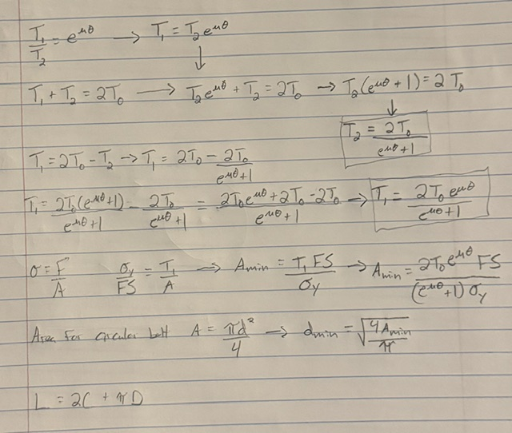

#### Free Body Diagram

I drew the pulley system to show the tight and loose sides of the belt. Since both pulleys have the same diameter, the belt wraps halfway around each pulley.

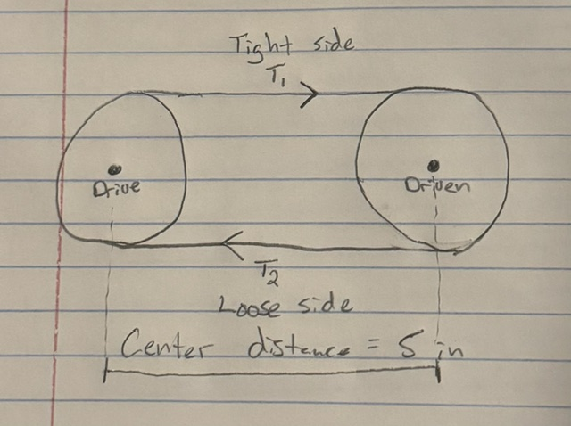

#### Symbolic Calculations

I first worked through the equations using variables before plugging in any numbers. I used the belt friction equation and the initial tension to find expressions for the two belt forces. I then rearranged the stress equation to solve for the minimum belt area and diameter.

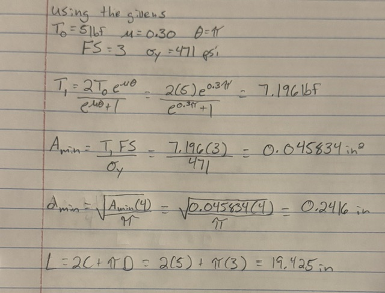

#### Numerical Calculations

After finding the symbolic equations, I substituted my selected values. I calculated the tight-side tension and used it to determine the minimum belt diameter. I also calculated the belt length using the pulley diameter and center distance.

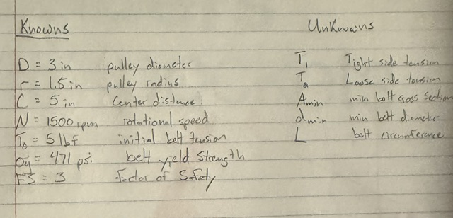

#### Belt Selection

The minimum calculated belt diameter was 0.2416 inches, so I selected a 1/4-inch polyurethane round belt from McMaster-Carr. The calculated belt length was approximately 19.425 inches. The coefficient of friction of 0.30 was assumed for this design.

### 2. Shaft Design

I used the belt forces from the first section to calculate the torque acting on the shaft. I chose 1060 hardened steel for the shaft material and used the torsional shear stress equation from Machinery's Handbook to determine the minimum diameter.

#### Knowns and Unknowns

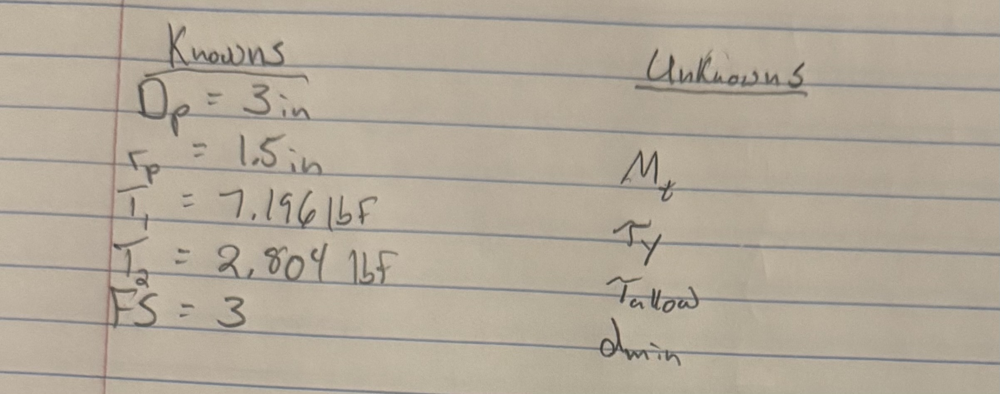

#### Free Body Diagram

The shaft is supported by bearings, while the pulley transfers torque to the shaft. I used the difference between the tight-side and loose-side belt forces to calculate the torque.

#### Symbolic Calculations

I started with the torsional shear stress equation and rearranged it to solve for the shaft diameter. I kept the equations symbolic before substituting the design values.

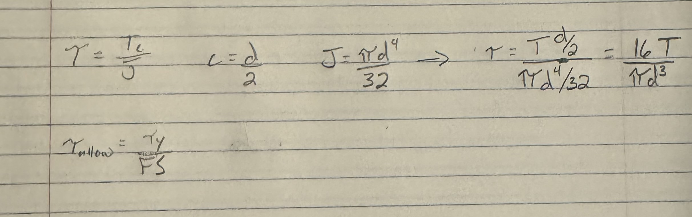

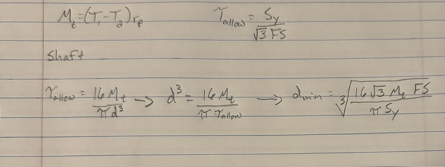

#### Numerical Calculations

I calculated a transmitted torque of 6.588 lbf-in and used an assumed yield strength of 85,000 psi for the hardened steel. This gave a minimum shaft diameter of approximately 0.1271 inches.

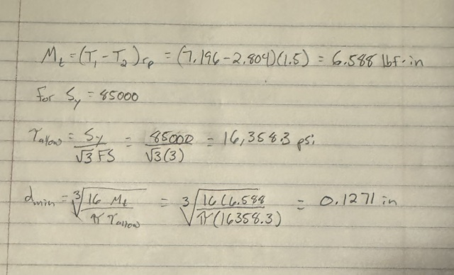

#### Shaft Selection

I selected a 0.500-inch diameter shaft because it is a more practical size for the bearings and provides additional strength. The calculation was based on torsional stress, so bending and deflection would still need to be considered for a final design.

### 3. Journal Bearing Selection

I used the forces from the belt to figure out how much load each bearing would support. I assumed the pulley was centered between two bearings so the load would be divided equally. I then calculated the bearing pressure, shaft surface velocity, and PV value to help select a bearing material.

#### Knowns and Unknowns

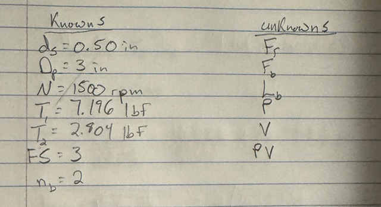

#### Free Body Diagram

The shaft is supported by two bearings, labeled A and B. Since the pulley is centered between them, each bearing supports half of the radial belt load.

#### Symbolic Calculations

I started with the equations for bearing load, pressure, and surface velocity. I then combined the pressure and velocity equations to find the PV relationship before substituting any numbers.

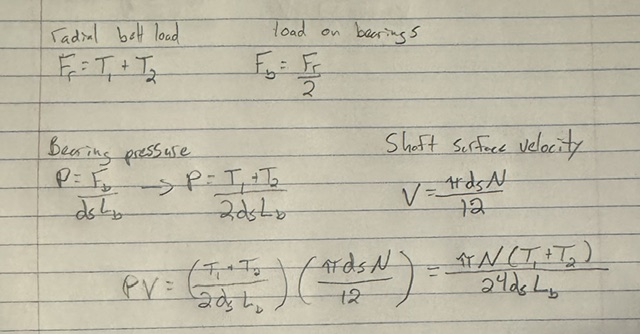

#### Numerical Calculations

I chose a bearing length of 0.750 inches and calculated the load on each bearing to be 5 lbf. The bearing pressure was 13.33 psi, the surface velocity was 196.35 ft/min, and the PV value was approximately 2618 psi-ft/min.

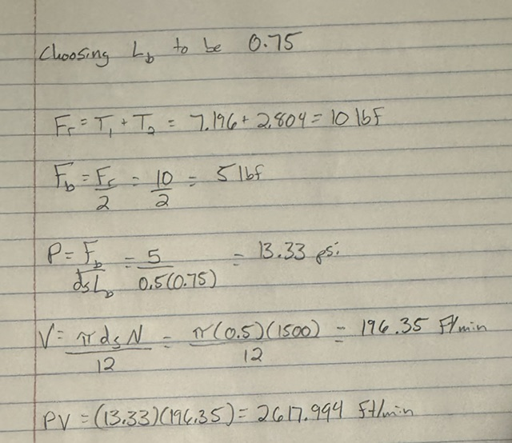

#### Bearing Material Selection

I compared my calculated values with Table 4 from Machinery's Handbook. I selected porous bronze as a possible bearing material because its listed load, speed, and PV limits are higher than my calculated values. The final selection would also need to account for lubrication and operating temperature.

### 4. Frame Analysis

For the frame, I wanted to make sure the supports could handle the forces coming from the pulley system. I chose a simple aluminum support and treated it like a cantilever beam. I calculated the bending stress and compared it to the material's assumed yield strength to check the factor of safety.

#### Knowns and Unknowns

I chose a support height of 2 inches, a width of 1 inch, and a thickness of 0.25 inches. Each support was assumed to carry a 5 lbf load.

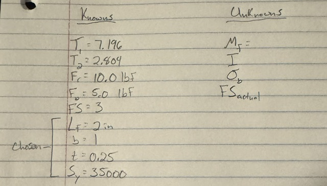

#### Free Body Diagram

For the frame analysis, I modeled the support as a cantilever with a 5 lbf horizontal force acting at the top and a fixed connection at the bottom.

#### Symbolic and Numerical Calculations

I started with the bending stress equation and rearranged it using the moment of inertia for a rectangular cross section. After substituting the dimensions, I calculated the bending stress and checked the factor of safety.

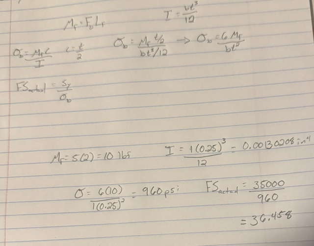

#### Frame Results

The calculated bending stress was 960 psi, and the factor of safety was approximately 36.46 using an assumed yield strength of 35,000 psi. This is higher than the required factor of safety of 3 for the simplified support model. A final frame design would also need to consider mounting connections and alignment.

## Decide

### Final Design Selections

After completing the calculations, I selected a 1/4-inch polyurethane round belt, two 3-inch aluminum pulleys, and a 0.500-inch diameter 1060 hardened steel shaft. For the bearings, I chose porous bronze with a 0.500-inch inside diameter and a length of 0.750 inches. The frame uses aluminum supports that are 2 inches tall, 1 inch wide, and 0.250 inches thick.

The calculations showed that the selected dimensions meet the required factor of safety of 3 for the simplified stress models. Some material properties were assumed, so these would need to be verified before actually building the system.

## Communicate

### Lessons Learned

This assignment helped me understand how the different parts of a pulley system affect each other. I learned that the forces in the belt are not equal when the system is transmitting torque, and that the difference between those forces determines how much torque is transferred to the shaft.

I also learned how to use the torque to find the minimum shaft diameter and how the shaft size affects the bearings I can use. The bearing calculations showed me why pressure and surface speed both matter when choosing a material.

One thing I found interesting was how much larger the actual parts can be compared to the calculated minimum sizes. I also realized that choosing a part is not just about making it strong enough, but also making sure it works with the other components.

### References

- D. J. Dunn, *Solid Mechanics - Dynamics: Pulley Drive Systems*.
- *Machinery's Handbook*, Table 2: Simple Stresses.
- *Machinery's Handbook*, Table 4: Application Limits - Sintered Metal and Nonmetallic Bearings.
- McMaster-Carr, Round Belts.

